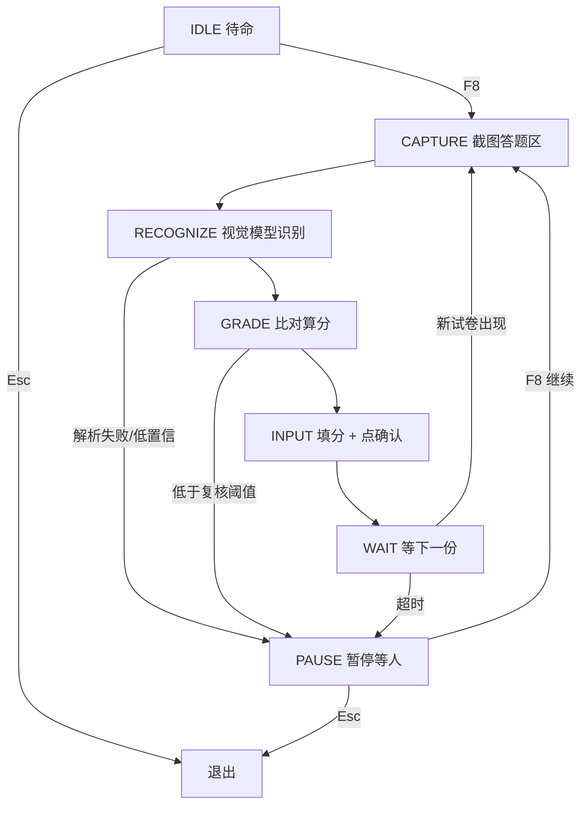

# auto-grader-pilot 设计文档

## 项目信息

| 项 | 值 |
|---|---|
| 类型 | CLI 桌面自动化工具（单进程，无 GUI 窗口） |
| 平台 | Windows 10/11（PyAutoGUI + pynput 键鼠） |
| 语言/运行时 | Python 3.11+（实测 3.14 可用） |
| 构建 | `pip install -e .`（pyproject.toml / setuptools） |
| CI/CD | 无。个人工具，本地跑。 |
| 依赖 | `pyautogui`、`pynput`、`pillow`、`opencv-python`（locate 置信度）、`openai`（兼容 OpenAI 协议的视觉模型）、`pyyaml` |

## 一句话目标

固定屏幕上某块「答题区」→ 截图 → 视觉模型识别学生答案 → 按标准答案算分 → 在分数框填分并点确认 → 等下一份试卷 → 循环。

## 流程（状态机）



热键（pynput 全局监听，不抢焦点）：

| 键 | 作用 |
|---|---|
| F8 | 启动 / 暂停后继续 |
| F9 | 只跑一轮（调试） |
| F10 | 跳过当前学生（不填分，直接等下一份） |
| Esc | 停止 |

## 模块划分

```
src/agp/
  config.py       # YAML 读取 + 校验（缺字段直接报错退出）
  logging_setup.py# 控制台 + runs/<ts>/run.log，控制台按级别着色
  capture.py      # 按 region 截图 -> PIL.Image -> 落盘 PNG
  vision.py       # OpenAI 兼容视觉调用，重试/退避，返回结构化 dict
  grade.py        # 纯函数：recognized + answer_key -> score + 明细（可单测）
  ui.py           # 模板定位 click / type / wait_for，含降级坐标
  controller.py   # 上面的状态机 + 热键 + 每轮产物落盘
  cli.py          # argparse：--config --once --dry-run --debug --max-rounds
scripts/
  region_picker.py# 拖框取坐标，打印到控制台，粘进 config.yaml
```

## 配置（config.yaml）

```yaml
vision:
  base_url: https://api.openai.com/v1      # 通义/DeepSeek 等填各自兼容地址
  api_key: ${AGP_API_KEY}                  # 支持环境变量展开
  model: gpt-4o-mini
  timeout_s: 30
  retries: 3

regions:                                   # 屏幕绝对像素坐标
  answer:   {left: 300, top: 200, width: 900, height: 500}
  score:    {left: 1100, top: 820, width: 80,  height: 30}

templates:                                 # 模板图放 assets/templates/
  confirm_btn: assets/templates/confirm_btn.png
  next_btn:    assets/templates/next_btn.png     # 可选，没有就走像素变化检测
  confidence: 0.85
  fallback_click: {x: 1150, y: 860}        # 模板连续 3s 找不到才用

grading:
  answer_key: answers.json
  review_below: 60          # 低于此分不自动提交，暂停等人
  pass_score: 90
  normalize: [strip, upper, 全角转半角]

loop:
  next_timeout_s: 20        # 等下一份试卷
  change_ratio: 0.02        # 答题区像素差异占比超过此值视为换卷
  max_rounds: 0             # 0 = 无限
```

### answers.json（标准答案）

```json
{
  "exam_id": "demo",
  "questions": [
    {"id": "1", "type": "single", "answer": "A", "points": 5},
    {"id": "2", "type": "multi",  "answer": "ACD", "points": 10},
    {"id": "3", "type": "judge",  "answer": "正确", "points": 5},
    {"id": "4", "type": "fill",   "answer": ["光合作用", "photosynthesis"], "points": 10}
  ]
}
```

计分规则：

| type | 判定 |
|---|---|
| single / judge | 归一化后相等得满分 |
| multi | 集合完全相等得满分；默认无部分分（`partial: false` 可开） |
| fill | 命中 `answer` 数组任一项得满分（模糊：去空白+忽略大小写） |

## 视觉调用契约

发给模型的 prompt 固定，要求只回 JSON：

```json
{"student_id": "张三/001", "answers": {"1": "A", "2": "AC", "3": "正确", "4": "光合作用"}, "confidence": 0.92, "notes": ""}
```

解析失败（不是合法 JSON、缺 `answers`）→ 重试 1 次，仍失败 → PAUSE 并保留截图与响应原文。

## 每轮产物（可回放）

```
runs/2026-11-18T11-40-00/
  0001/
    answer.png       截图
    request.json     发出去的 payload（图用相对路径，便于回放）
    response.json    模型原始返回
    result.json      {student_id, answers, score, detail, action: "submit"|"skip"|"paused"}
  run.log
  events.jsonl       每轮一行，含耗时
```

`--replay runs/.../0001` 不碰屏幕、不调 API，直接跑 grade 流程，用于改规则后验证历史数据。

## 调试与日志

| 手段 | 说明 |
|---|---|
| `--dry-run` | 不点击不输入，只把「会点什么、会填什么」打到日志 |
| `--once` | 只跑一轮就退 |
| `--debug` | DEBUG 级别；每步前后打状态；模板匹配打印所有候选分数 |
| `region_picker.py` | 交互拖框，输出可直接复制的 region YAML |
| `events.jsonl` | 结构化，一行一轮，方便 `jq`/pandas 统计 |
| 截图留档 | 每轮必存，命名固定，方便人工复核 |

日志格式：`2026-11-18 11:40:02.113 INFO  [round 3] grade score=85/100 (single:2/3 ok)`

## 边界与错误处理

| 场景 | 处理 |
|---|---|
| 截图全白/被遮挡 | 模型返回低置信或 `answers` 空 → PAUSE + 蜂鸣 |
| API 超时 / 429 | 指数退避重试 3 次（2s/4s/8s），仍失败 PAUSE，不提交 |
| 模板找不到（窗口移位/最小化） | 连续 3s 扫描 → 记录候选 → 降级 `fallback_click` → 日志 WARN |
| 模板置信度 < `confidence` | 不点，PAUSE（防误点别处） |
| 分数框有旧值 | 点进框 → `ctrl+a` → 输入新值 |
| 算出的分数非数字/超范围 | clamp 到 `[0, 满分]` 并 WARN，仍然 PAUSE 等人工确认 |
| 同一学生被抓两次 | 答题区截图 pHash 相同则跳过（连续 3 轮相同 → PAUSE） |
| 等下一份超时 | PAUSE，热键可继续 |
| 鼠标甩到屏幕左上角 | PyAutoGUI FAILSAFE 触发 `FailSafeException` → 正常退出并写日志 |
| 分数 ≥ `review_below` | 自动提交；低于则 PAUSE，人工按 F8 确认提交 |

## 测试

- `tests/test_grade.py`：pytest 覆盖 4 种题型、部分分开关、归一化、超范围 clamp。
- `tests/test_vision_parse.py`：喂 3 种脏返回（带 ```json 包裹、前后有说明文字、字段缺失）。
- 手测清单：region 校准 → `--once --dry-run` → `--once` → 小样本 3 轮。

## 不做

- 不做 GUI 设置界面（改 YAML 就够）。
- 不做学生库/成绩数据库（每轮落 JSON，导出靠 events.jsonl）。
- 不做多显示器自动布局识别（region 手填绝对坐标）。
- 不做手写体专项优化（识别质量由所选视觉模型决定）。
